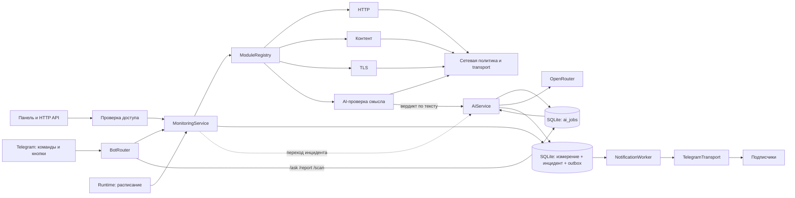

# Архитектура PulseDesk

Проверочные модули отделены от доменного слоя, хранения, Telegram и HTTP. Модули не отправляют сообщения и не пишут SQL: они валидируют конфигурацию и возвращают измерение.



## Поток события

1. Runtime выбирает до трёх наступивших проверок, начиная с самых просроченных.
2. MonitoringService объединяет параллельные вызовы одной проверки в одну Promise.
3. Модуль выполняет ограниченное сетевое чтение и возвращает `{ healthy, summary, latencyMs, meta }`.
4. Store одной транзакцией `BEGIN IMMEDIATE` сохраняет измерение, состояние, переход инцидента и уведомления подписчиков.
5. Outbox-worker забирает сообщение с lease, отправляет и фиксирует `sent` либо следующую попытку. После пяти неудач — `dead` с ручным повтором.

Webhook-updates сначала сохраняются с уникальным `update_id`, затем подтверждаются HTTP 200 и обрабатываются worker. В polling offset считается по сохранённым ID. Дедупликация inbox не даёт exactly-once гарантии внешних побочных эффектов при аварии.

## Новый модуль

Создай `src/modules/<name>/index.cjs` и зарегистрируй его в `src/modules/index.cjs`. Модули — доверенный серверный код владельца, не загружаемые пользовательские JavaScript-файлы.

Пример расширения для JSON health-check, использующего общий безопасный HTTPS-транспорт:

```javascript
'use strict'
const { validateUrl } = require('../../core/network.cjs')
module.exports = {
  id: 'json-health',
  title: 'JSON health-check',
  command: '/json',
  description: 'Проверяет поле status в JSON-ответе API.',
  fields: [{ key: 'target', label: 'HTTPS API', required: true }],
  fromCommand(args) {
    const [target, name] = args.split('|').map(part => part.trim())
    return { target, name: name || 'JSON API' }
  },
  validate(input) {
    return { target: validateUrl(input.target).href, config: {} }
  },
  async check(monitor, context) {
    const response = await context.transport.http(monitor.target, {
      signal: context.signal,
    })
    const json = JSON.parse(response.text)
    return {
      healthy: response.status === 200 && json.status === 'ok',
      summary: json.status === 'ok' ? 'API сообщает ok' : 'API сообщает проблему',
      latencyMs: response.latencyMs,
    }
  },
}
```

В реестре добавь `.register(require('./json-health/index.cjs'))`. Пример описывает следующее расширение; JSON health-check не входит в три включённых модуля версии 0.1.0 и требует тестов своего API-контракта.

BotRouter найдёт команду через `command/fromCommand`; `fields` сформируют поля панели; описание попадёт в API и `/help`. История, инциденты, доставка и scheduler останутся общими.

| Поле | Назначение |
| --- | --- |
| `id` | Уникальный идентификатор из латинских строчных букв, цифр и `-` |
| `title`, `description` | Название и описание |
| `command`, `fromCommand(args)` | Telegram-команда и разбор в `{ name, target, config }` |
| `fields` | Поля формы: `key`, `label`, `placeholder`, `required`, `type` |
| `validate(input)` | Нормализация в `{ target, config }`, без сети |
| `check(monitor, context)` | Асинхронный `{ healthy, summary, latencyMs?, meta? }` |

Контекст содержит transport, `now()` и AbortSignal. Используй signal для внешней работы. Ошибка модуля становится отрицательным измерением; отмена при выключении не создаёт ложного инцидента. Новый транспорт требует собственных ограничений адресов, времени и объёма.

## AI-слой

`src/ai/` не зависит от Telegram и HTTP: `AiService` получает store, реестр, transport и клиента модели.

1. **Наблюдатель.** `MonitoringService.observe()` сообщает о переходе после коммита транзакции. При `opened` AiService ставит задачу `incident` с фрагментом страницы. Ошибка наблюдателя не отменяет измерение.
2. **Очередь `ai_jobs`.** Задачи `incident`, `digest`, `ask`, `scan` с dedupe-ключом, lease на 3 минуты, тремя попытками и состоянием `skipped` при выключенном AI или исчерпанном лимите. `Runtime.kickAi()` запускает обработку рядом с основным циклом, поэтому вызов модели не задерживает проверки.
3. **Доставка.** Результаты уходят через существующий outbox: `analysis` — подписчикам, `message` — в конкретный чат, с inline-кнопками при необходимости.
4. **Синхронный вердикт.** Модуль `ai-page` вызывает `judgePage()` внутри проверки. Кэш `ai_cache` по отпечатку видимого текста и пауза `PULSE_AI_PAGE_RECHECK_MINUTES` ограничивают число вызовов. При ошибке модели модуль возвращает результат по HTTP, а не отрицательное измерение.
5. **Бюджет.** `allowCall()` решает, разрешён ли вызов, по дневной статистике `ai_usage`: запросы, токены, стоимость из `usage.cost` OpenRouter, пропуски. Разбор инцидентов и AI-проверки страниц могут израсходовать весь `PULSE_AI_DAILY_LIMIT`, а `/ask`, `/scan` и отчёты останавливаются на 80%, чтобы всплеск вопросов не оставил реальный сбой без разбора.
6. **Отчёты.** `daily_stats` накапливает измерения по дням в той же транзакции, что и `checks`, поэтому недельный отчёт не зависит от лимита 720 сырых записей. Без модели отчёт собирается по шаблону.

Ответы со структурой (`incident`, `page`, `scan`) запрашиваются по строгой JSON-схеме. Предложения `/scan` проходят `registry.create()`, а фраза для `content` должна дословно встречаться на странице. Текст страниц передаётся модели как недоверенные данные внутри `<page>`.

## Слои хранения и доступа

- `monitors`, `checks`, `incidents` — состояние и история.
- `subscribers`, `outbox` — подписки и доставка.
- `telegram_updates` — устойчивый inbox.
- `leases` — один фоновый процесс, heartbeat и TTL 60 секунд.
- `daily_stats` — дневные агрегаты измерений для отчётов, 120 дней.
- `ai_jobs`, `ai_usage`, `ai_cache` — очередь AI-задач, дневной расход и кэш вердиктов; `incidents.analysis` — AI-разбор.
- `migrations` — версия схемы; изменения оформляются отдельной миграцией (`migrate(2, …)` добавила AI-таблицы).
- `settings`, `demo_messages` — демонстрационные сценарии.

Live API закрыт отдельным ключом. Webhook использует другой обязательный секрет. Telegram разрешён только явному allowlist и личным чатам. Demo не читает прежний `.env`, не использует live-базу по `PULSE_DATABASE` и не обращается к сети, кроме OpenRouter при заданном `PULSE_OPENROUTER_API_KEY`.

## Куда развивать

| Возможность | Слой расширения |
| --- | --- |
| JSON API, DNS, срок домена | Новый модуль и, при необходимости, безопасный транспорт |
| Порог задержки | Настройки HTTP-модуля и критерий инцидента |
| Новая AI-функция | Новый `kind` в `AiService.handle()`, промпт в `prompts.cjs`, доставка через outbox |
| Другая модель | `PULSE_AI_MODEL`; другой провайдер — клиент с тем же `complete()` |
| Email или другой мессенджер | Канальный адаптер и миграция маршрутов доставки |
| Разные роли команды | Модель пользователей и разрешений; allowlist не заменяет RBAC |
| Несколько клиентов | Изоляция проектов во всех запросах, ключах и авторизации |
| Публичное демо | Отдельная demo-база, сессии, ограничения ресурсов и reverse proxy; не снятие loopback-проверки текущего локального режима |

Новый мессенджер является адаптером доставки, а многопользовательская модель требует изменения домена и хранения. Не каждое расширение сводится к одному проверочному модулю.
